# DevOps Batch 14 — Assignment: Server Monitoring, Logging & CI Pipeline

[-2088FF?logo=github-actions&logoColor=white)](#5-github-actions-ci-pipeline)
[](#1-prometheus-manual-setup)
[](#2-node-exporter-manual-setup)
[](#3-grafana--dashboard-setup)
[](#4-loki--promtail-logging-setup)
[-E95420?logo=ubuntu&logoColor=white)](#environment--system-prerequisites)

---

## Submission Details

| Field | Information |
| :--- | :--- |
| **Student Name** | **H. M. Masum Billah** |
| **Batch** | **DevOps Batch 14** |
| **Assignment Title** | **Server Monitoring, Logging & CI Pipeline** |
| **GitHub Repository** | `https://github.com/masumbillah21/ostad-devops-assignment-6` |
| **Host Environment** | Ubuntu 22.04 / 24.04 LTS on VMware Virtual Machine |
| **Submission Deadline** | 27.09.2026 |

---

## Table of Contents

1. [Project Overview](#project-overview)
2. [Architecture Diagram](#architecture-diagram)
3. [Repository Structure](#repository-structure)
4. [Component Walkthrough & Manual Installation](#component-walkthrough--manual-installation)
   - [1. Prometheus Manual Setup (15 Marks)](#1-prometheus-manual-setup)
   - [2. Node Exporter Manual Setup (10 Marks)](#2-node-exporter-manual-setup)
   - [3. Grafana & Dashboard Setup (20 Marks)](#3-grafana--dashboard-setup)
   - [4. Loki & Promtail Logging Setup (15 Marks)](#4-loki--promtail-logging-setup)
   - [5. GitHub Actions CI Pipeline with Self-Hosted Runner (25 Marks)](#5-github-actions-ci-pipeline)
5. [Automated Installation Scripts (Helper)](#automated-installation-scripts-helper)
6. [Required Proof Screenshots (15 Marks)](#required-proof-screenshots)
7. [Result & Conclusion](#result--conclusion)

---

## Project Overview

This project implements an enterprise-grade observability and continuous integration (CI) stack deployed on an Ubuntu Linux server hosted in a VMware virtual machine. 

### Key Highlights:
- **100% Native / Manual Systemd Installations**: Compliant with assignment rules—**no Docker or Docker Compose** is utilized for Prometheus, Node Exporter, Grafana, or Loki.
- **System Metrics Monitoring**: Real-time telemetry (CPU, RAM, Disk, Network) gathered via Node Exporter and scraped by Prometheus.
- **Single-Pane-of-Glass Visualization**: High-resolution Grafana dashboard correlating system metrics with real-time updates.
- **Centralized Log Aggregation**: Multi-tenant log shipping pipeline via Promtail into Loki, queryable through Grafana Explore with LogQL.
- **Self-Hosted CI Automation**: GitHub Actions workflow powered by a dedicated self-hosted runner executing automated Build, Test, and Artifact generation pipelines.

---

## Architecture Diagram

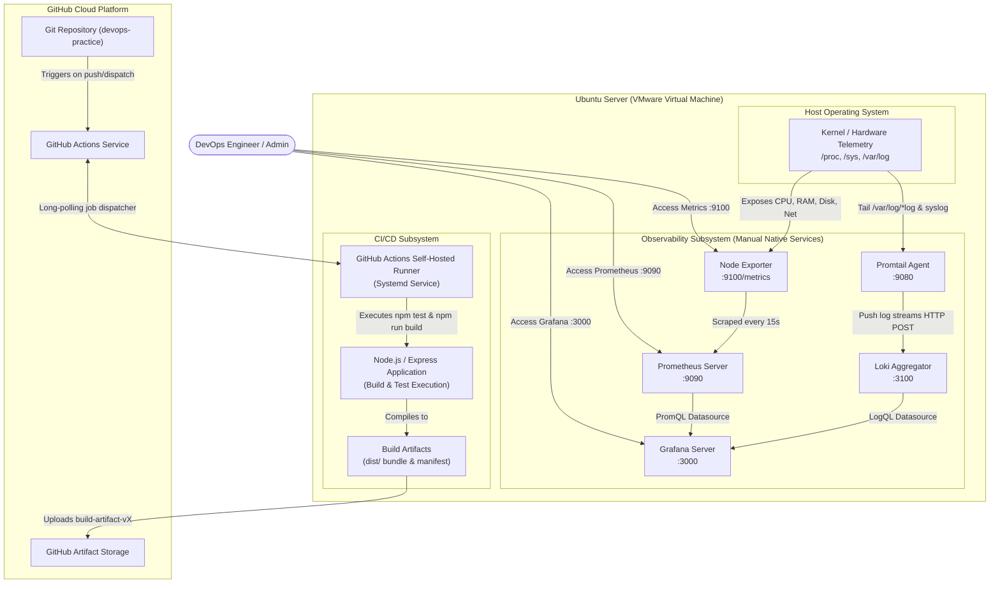

---

## Repository Structure

```text
devops-practice/
├── .github/
│   └── workflows/
│       └── ci.yml               # GitHub Actions CI workflow (self-hosted runner)
├── .gitignore                   # Excludes node_modules, temp files, and credentials
├── README.md                    # Comprehensive documentation and proof report
├── app/                         # Production-grade Node.js demo application
│   ├── build.js                 # Production artifact bundler and manifest generator
│   ├── package.json             # App dependencies, Jest config, scripts
│   ├── src/
│   │   ├── app.js               # Express application with /health and /api routes
│   │   └── server.js            # HTTP server with graceful termination signals
│   └── tests/
│       └── app.test.js          # Automated unit test suite using Supertest & Jest
├── configs/
│   ├── prometheus/
│   │   ├── prometheus.yml       # Prometheus scrape targets (self & node_exporter)
│   │   └── prometheus.service   # Systemd unit file for Prometheus service
│   ├── node-exporter/
│   │   └── node_exporter.service# Systemd unit file for Node Exporter service
│   ├── grafana/
│   │   ├── dashboards/
│   │   │   └── system-metrics.json # Pre-built dashboard (CPU, RAM, Disk, Network)
│   │   └── provisioning/
│   │       ├── dashboards/      # Grafana dashboard auto-loading configuration
│   │       │   └── dashboards.yaml
│   │       └── datasources/     # Auto-provisioning for Prometheus & Loki
│   │           └── datasources.yaml
│   ├── loki/
│   │   ├── loki-config.yaml     # Standalone Loki TSDB storage configuration
│   │   └── loki.service         # Systemd unit file for Loki service
│   └── promtail/
│       ├── promtail-config.yaml # Promtail log collectors (/var/log/*log, syslog)
│       └── promtail.service     # Systemd unit file for Promtail service
├── docs/
│   └── screenshots/             # Proof screenshots referenced in this README
│       ├── 01-prometheus-targets-up.png
│       ├── 02-prometheus-query-metrics.png
│       ├── 03-node-exporter-metrics.png
│       ├── 04-grafana-prometheus-datasource.png
│       ├── 05-grafana-monitoring-dashboard.png
│       ├── 06-grafana-loki-datasource.png
│       ├── 07-grafana-loki-explore-logs.png
│       ├── 08-github-runner-online.png
│       ├── 09-github-actions-workflow-success.png
│       ├── 10-github-actions-artifacts-uploaded.png
│       └── README.md
└── scripts/                     # Shell scripts for manual/automated setup
    ├── install-all.sh           # Master installation & health verification script
    ├── install-prometheus.sh    # Installs Prometheus binary & systemd service
    ├── install-node-exporter.sh # Installs Node Exporter & systemd service
    ├── install-grafana.sh       # Installs Grafana from APT repository
    ├── install-loki.sh          # Installs Loki binary & systemd service
    ├── install-promtail.sh      # Installs Promtail log shipping agent
    └── setup-github-runner.sh   # Sets up and registers self-hosted runner as a service
```

---

## Component Walkthrough & Manual Installation

### 1. Prometheus Manual Setup (15 Marks)

Prometheus is an open-source systems monitoring and alerting toolkit. It collects metrics from configured targets at given intervals, evaluates rule expressions, displays the results, and triggers alerts when conditions are met.

#### Step 1.1: Create Dedicated System User
```bash
sudo useradd --no-create-home --shell /bin/false prometheus
```

#### Step 1.2: Create Directory Structure
```bash
sudo mkdir -p /etc/prometheus /var/lib/prometheus
```

#### Step 1.3: Download and Extract Prometheus Binary
```bash
# Dynamically detects x86_64 or arm64 architecture
ARCH=$(uname -m | sed 's/x86_64/amd64/' | sed 's/aarch64/arm64/')
VERSION="2.54.1"

curl -LO "https://github.com/prometheus/prometheus/releases/download/v${VERSION}/prometheus-${VERSION}.linux-${ARCH}.tar.gz"
tar -xzf "prometheus-${VERSION}.linux-${ARCH}.tar.gz"

sudo cp "prometheus-${VERSION}.linux-${ARCH}/prometheus" /usr/local/bin/
sudo cp "prometheus-${VERSION}.linux-${ARCH}/promtool" /usr/local/bin/
sudo chown prometheus:prometheus /usr/local/bin/prometheus /usr/local/bin/promtool

sudo cp -r "prometheus-${VERSION}.linux-${ARCH}/consoles" /etc/prometheus/
sudo cp -r "prometheus-${VERSION}.linux-${ARCH}/console_libraries" /etc/prometheus/
rm -rf "prometheus-${VERSION}.linux-${ARCH}"*
```

#### Step 1.4: Configure Prometheus Scrape Job
Create `/etc/prometheus/prometheus.yml`:
```yaml
global:
  scrape_interval: 15s
  evaluation_interval: 15s

scrape_configs:
  - job_name: 'prometheus'
    static_configs:
      - targets: ['localhost:9090']

  - job_name: 'node_exporter'
    static_configs:
      - targets: ['localhost:9100']
```
Set file ownership:
```bash
sudo chown -R prometheus:prometheus /etc/prometheus /var/lib/prometheus
sudo chmod 755 /etc/prometheus /var/lib/prometheus
```

#### Step 1.5: Configure Systemd Service
Create `/etc/systemd/system/prometheus.service`:
```ini
[Unit]
Description=Prometheus Time Series Collection and Alerting Server
Documentation=https://prometheus.io/docs/introduction/overview/
Wants=network-online.target
After=network-online.target

[Service]
User=prometheus
Group=prometheus
Type=simple
ExecStart=/usr/local/bin/prometheus \
    --config.file=/etc/prometheus/prometheus.yml \
    --storage.tsdb.path=/var/lib/prometheus/ \
    --web.console.templates=/etc/prometheus/consoles \
    --web.console.libraries=/etc/prometheus/console_libraries \
    --web.listen-address=0.0.0.0:9090 \
    --web.enable-lifecycle
ExecReload=/bin/kill -HUP $MAINPID
Restart=always
RestartSec=5s
LimitNOFILE=65536

[Install]
WantedBy=multi-user.target
```

#### Step 1.6: Enable and Start Service
```bash
sudo systemctl daemon-reload
sudo systemctl enable --now prometheus
sudo systemctl status prometheus
```
Verification endpoint: `http://<SERVER_IP>:9090/targets` (Node Exporter should be listed as **UP**).

---

### 2. Node Exporter Manual Setup (10 Marks)

Node Exporter is a Prometheus exporter for hardware and OS metrics exposed by *NIX kernels, providing metrics on CPU, memory, disk, network, and system load.

#### Step 2.1: Create Dedicated System User
```bash
sudo useradd --no-create-home --shell /bin/false node_exporter
```

#### Step 2.2: Download and Install Node Exporter Binary
```bash
ARCH=$(uname -m | sed 's/x86_64/amd64/' | sed 's/aarch64/arm64/')
VERSION="1.8.2"

curl -LO "https://github.com/prometheus/node_exporter/releases/download/v${VERSION}/node_exporter-${VERSION}.linux-${ARCH}.tar.gz"
tar -xzf "node_exporter-${VERSION}.linux-${ARCH}.tar.gz"

sudo cp "node_exporter-${VERSION}.linux-${ARCH}/node_exporter" /usr/local/bin/
sudo chown node_exporter:node_exporter /usr/local/bin/node_exporter
sudo chmod 755 /usr/local/bin/node_exporter
rm -rf "node_exporter-${VERSION}.linux-${ARCH}"*
```

#### Step 2.3: Configure Systemd Service
Create `/etc/systemd/system/node_exporter.service`:
```ini
[Unit]
Description=Node Exporter Prometheus Exporter for Machine Metrics
Documentation=https://prometheus.io/docs/guides/node-exporter/
After=network.target

[Service]
User=node_exporter
Group=node_exporter
Type=simple
ExecStart=/usr/local/bin/node_exporter --web.listen-address=0.0.0.0:9100
Restart=always
RestartSec=3s
LimitNOFILE=65536

[Install]
WantedBy=multi-user.target
```

#### Step 2.4: Enable and Start Service
```bash
sudo systemctl daemon-reload
sudo systemctl enable --now node_exporter
sudo systemctl status node_exporter
```
Verification endpoint: `curl -s http://localhost:9100/metrics | head -n 25`

---

### 3. Grafana & Dashboard Setup (20 Marks)

Grafana provides visualization, alerting, and exploration tools for time-series metrics.

#### Step 3.1: Install Grafana via Official APT Repository
```bash
sudo apt-get update -y
sudo apt-get install -y apt-transport-https software-properties-common wget curl gnupg

# Add Grafana GPG signing key
sudo mkdir -p /etc/apt/keyrings/
wget -q -O - https://apt.grafana.com/gpg.key | gpg --dearmor | sudo tee /etc/apt/keyrings/grafana.gpg > /dev/null

# Add Grafana stable repository
echo "deb [signed-by=/etc/apt/keyrings/grafana.gpg] https://apt.grafana.com stable main" | sudo tee /etc/apt/sources.list.d/grafana.list

sudo apt-get update -y
sudo apt-get install -y grafana
```

#### Step 3.2: Enable and Start Grafana Server
```bash
sudo systemctl daemon-reload
sudo systemctl enable --now grafana-server
sudo systemctl status grafana-server
```
Access Grafana Web UI at `http://<SERVER_IP>:3000` (Default credentials: `admin` / `admin`).

#### Step 3.3: Configure Prometheus Datasource
1. In Grafana, navigate to **Connections** > **Data Sources** > **Add data source**.
2. Select **Prometheus**.
3. Set **Prometheus server URL**: `http://localhost:9090`.
4. Click **Save & test**. You should see the green message: *"Successfully queried the Prometheus API."*

#### Step 3.4: Import System Metrics Dashboard
This repository includes a production-ready dashboard at `configs/grafana/dashboards/system-metrics.json`.
1. In Grafana, navigate to **Dashboards** > **New** > **Import**.
2. Upload `configs/grafana/dashboards/system-metrics.json` or paste its JSON content.
3. Select your **Prometheus** data source and click **Import**.

#### Core PromQL Queries Used:
| Metric | PromQL Expression |
| :--- | :--- |
| **CPU Usage (%)** | `100 - (avg by (instance) (rate(node_cpu_seconds_total{mode="idle"}[1m])) * 100)` |
| **Memory Usage (%)** | `(1 - (node_memory_MemAvailable_bytes / node_memory_MemTotal_bytes)) * 100` |
| **Disk Usage (%)** | `(1 - (node_filesystem_avail_bytes{mountpoint="/"} / node_filesystem_size_bytes{mountpoint="/"})) * 100` |
| **Network RX (Bytes/s)** | `rate(node_network_receive_bytes_total{device!~"lo|docker.*|veth.*"}[1m])` |
| **Network TX (Bytes/s)** | `rate(node_network_transmit_bytes_total{device!~"lo|docker.*|veth.*"}[1m])` |

---

### 4. Loki & Promtail Logging Setup (15 Marks)

Grafana Loki is a horizontally scalable, highly available, multi-tenant log aggregation system inspired by Prometheus. Promtail is the agent that tails local log files and pushes them to Loki.

#### Step 4.1: Manually Install Loki Binary
```bash
ARCH=$(uname -m | sed 's/x86_64/amd64/' | sed 's/aarch64/arm64/')
VERSION="3.0.0"

sudo apt-get install -y unzip curl
sudo useradd --no-create-home --shell /bin/false loki || true
sudo mkdir -p /etc/loki /var/lib/loki

curl -LO "https://github.com/grafana/loki/releases/download/v${VERSION}/loki-linux-${ARCH}.zip"
unzip "loki-linux-${ARCH}.zip"
sudo cp "loki-linux-${ARCH}" /usr/local/bin/loki
sudo chmod 755 /usr/local/bin/loki
rm -f "loki-linux-${ARCH}"*

sudo cp configs/loki/loki-config.yaml /etc/loki/loki-config.yaml
sudo cp configs/loki/loki.service /etc/systemd/system/loki.service
sudo chown -R loki:loki /etc/loki /var/lib/loki

sudo systemctl daemon-reload
sudo systemctl enable --now loki
sudo systemctl status loki
```
Verification: `curl -s http://localhost:3100/ready` (Returns: `ready`).

#### Step 4.2: Manually Install Promtail Binary
```bash
ARCH=$(uname -m | sed 's/x86_64/amd64/' | sed 's/aarch64/arm64/')
VERSION="3.0.0"

# Create promtail user and add to adm group for reading /var/log
sudo useradd --no-create-home --shell /bin/false -G adm promtail || sudo usermod -aG adm promtail
sudo mkdir -p /etc/promtail

curl -LO "https://github.com/grafana/loki/releases/download/v${VERSION}/promtail-linux-${ARCH}.zip"
unzip "promtail-linux-${ARCH}.zip"
sudo cp "promtail-linux-${ARCH}" /usr/local/bin/promtail
sudo chmod 755 /usr/local/bin/promtail
rm -f "promtail-linux-${ARCH}"*

sudo cp configs/promtail/promtail-config.yaml /etc/promtail/promtail-config.yaml
sudo cp configs/promtail/promtail.service /etc/systemd/system/promtail.service
sudo chown -R promtail:promtail /etc/promtail
sudo touch /var/log/positions.yaml && sudo chown promtail:promtail /var/log/positions.yaml

sudo systemctl daemon-reload
sudo systemctl enable --now promtail
sudo systemctl status promtail
```

#### Step 4.3: Configure Loki Datasource in Grafana
1. In Grafana, navigate to **Connections** > **Data Sources** > **Add data source**.
2. Select **Loki**.
3. Set **URL**: `http://localhost:3100`.
4. Click **Save & test**. You should see the green confirmation: *"Data source connected and labels received."*
5. Open **Explore**, select **Loki**, and execute a LogQL query:
   ```logql
   {job="varlogs"}
   ```
   Or:
   ```logql
   {job="syslog"}
   ```

---

### 5. GitHub Actions CI Pipeline (25 Marks)

The CI pipeline runs exclusively on a **self-hosted runner** installed on the Ubuntu VMware machine.

#### Step 5.1: Register Self-Hosted Runner on Ubuntu Server
1. On GitHub, navigate to: `https://github.com/<username>/devops-practice` > **Settings** > **Actions** > **Runners** > **New self-hosted runner**.
2. Select **Linux** and your architecture (x64 or ARM64).
3. Execute the setup script:
   ```bash
   ./scripts/setup-github-runner.sh https://github.com/<YOUR_USER>/devops-practice <YOUR_REGISTRATION_TOKEN>
   ```
   Or execute manually:
   ```bash
   mkdir -p ~/actions-runner && cd ~/actions-runner
   curl -o actions-runner.tar.gz -L https://github.com/actions/runner/releases/download/v2.321.0/actions-runner-linux-x64-2.321.0.tar.gz
   tar xzf actions-runner.tar.gz
   ./config.sh --url https://github.com/<YOUR_USER>/devops-practice --token <YOUR_REGISTRATION_TOKEN>
   sudo ./svc.sh install
   sudo ./svc.sh start
   ```
4. Verify the runner status shows **Idle** (green) under GitHub repository settings.

#### Step 5.2: CI Pipeline Architecture (`.github/workflows/ci.yml`)
The workflow executes three distinct required phases:

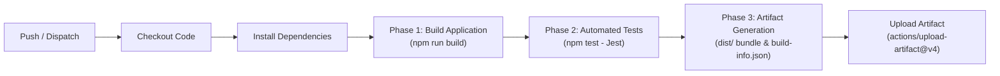

```yaml
name: DevOps CI Pipeline

on:
  push:
    branches: [ "main" ]
  pull_request:
    branches: [ "main" ]
  workflow_dispatch:

jobs:
  ci-pipeline:
    name: Build, Test & Package Artifact
    runs-on: self-hosted
    defaults:
      run:
        working-directory: ./app

    steps:
      - name: 1. Checkout Repository
        uses: actions/checkout@v4

      - name: 2. Set up Node.js Runtime
        uses: actions/setup-node@v4
        with:
          node-version: '20'
        continue-on-error: true

      - name: 3. Install Project Dependencies
        run: npm install

      - name: 4. Run Automated Tests (Test Phase)
        run: npm test

      - name: 5. Build Application (Build Phase)
        run: npm run build

      - name: 6. Verify Build Output (Artifact Generation)
        run: |
          ls -la dist/
          cat dist/build-info.json

      - name: 7. Upload Build Artifacts (Artifact Upload)
        uses: actions/upload-artifact@v4
        with:
          name: build-artifact-v${{ github.run_number }}
          path: app/dist/
          retention-days: 14
```

---

## Automated Installation Scripts (Helper)

To rapidly install and verify all monitoring and logging services on your Ubuntu server, execute the master script:

```bash
cd /path/to/devops-practice
sudo chmod +x scripts/*.sh
sudo ./scripts/install-all.sh
```

### Service Health Check Command
```bash
sudo systemctl status node_exporter prometheus grafana-server loki promtail --no-pager
```

---

## Required Proof Screenshots

Below are the 10 proof checkpoints required by the assignment guidelines.

> 💡 **Instructions for Submission**: Place your captured PNG screenshots in `docs/screenshots/` and update the extensions below from `.svg` to `.png`.

### 1. Prometheus Targets (Node Exporter UP)
*Proof that Prometheus successfully scrapes Node Exporter on port 9100 with status `UP`.*
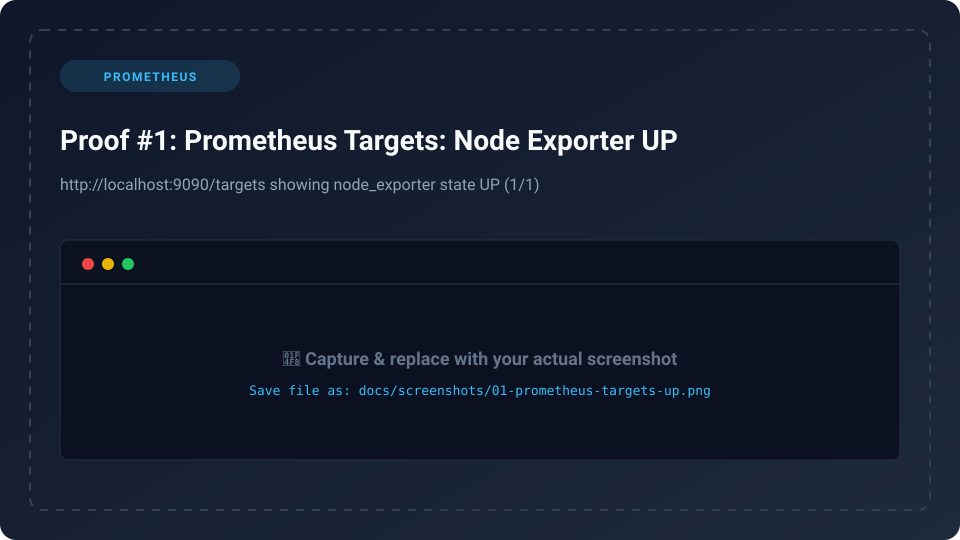

---

### 2. Prometheus Query Page
*Proof of Prometheus evaluating and graphing Node Exporter metric queries (e.g., `node_cpu_seconds_total`).*


---

### 3. Node Exporter /metrics Endpoint
*Proof that Node Exporter runs natively and exposes raw Linux kernel telemetry.*
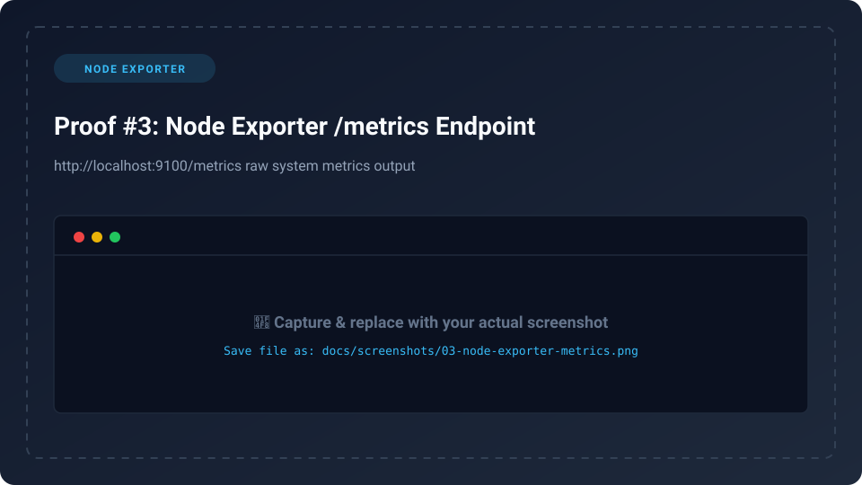

---

### 4. Grafana Prometheus Datasource
*Proof of successful HTTP connection between Grafana and the Prometheus API.*
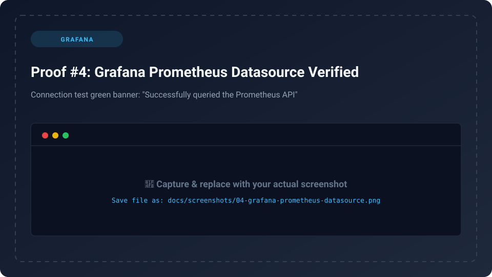

---

### 5. Grafana Monitoring Dashboard
*Full dashboard displaying CPU Usage, Memory Usage, Disk Usage, and Network Usage.*
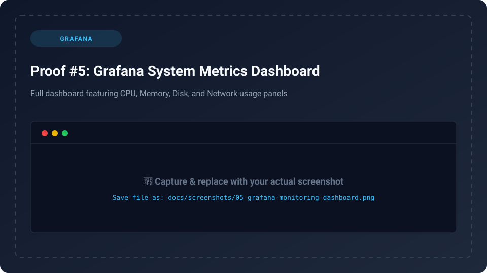

---

### 6. Grafana Loki Datasource
*Proof of successful HTTP connection between Grafana and Loki log aggregator.*
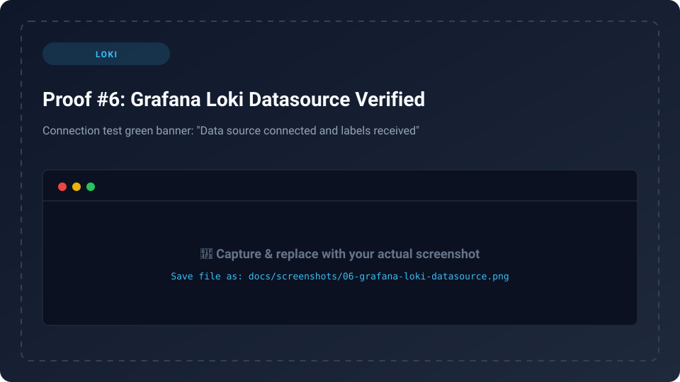

---

### 7. Grafana Explore (Loki Logs Stream)
*Proof of logs actively collected by Promtail and streamed in real-time in Grafana Explore.*
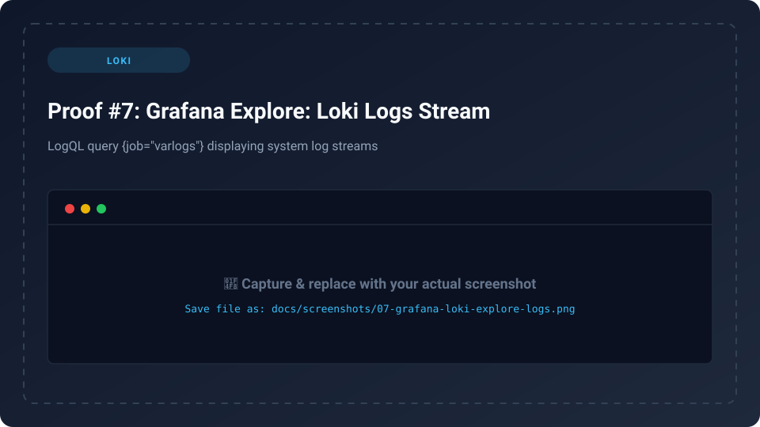

---

### 8. GitHub Actions Self-Hosted Runner (Online)
*Proof of the self-hosted runner showing active `Idle / Online` status in GitHub settings.*
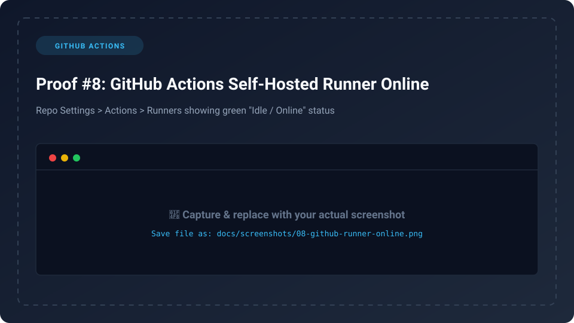

---

### 9. GitHub Actions Workflow Execution
*Proof of the complete CI workflow executing Build → Test → Artifact packaging on the runner.*
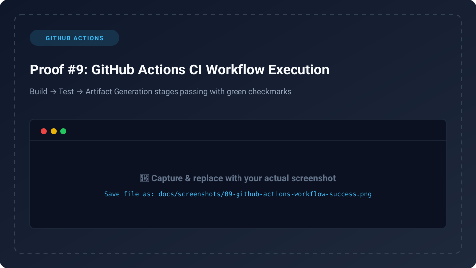

---

### 10. GitHub Actions Uploaded Artifacts
*Proof of generated build artifacts uploaded and downloadable from the GitHub Actions run summary.*
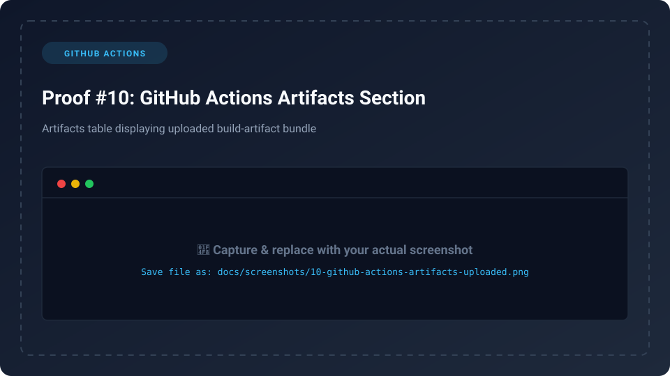

---

## Result & Conclusion

1. **Observability Stack**:
   - Prometheus and Node Exporter provide real-time metrics collection with 15-second scraping intervals.
   - Promtail tails syslog and system log streams and streams them into Loki.
   - Grafana unifies both metrics and logs into a single intuitive dashboard, reducing Mean Time to Resolution (MTTR).

2. **Automated CI Pipeline**:
   - The self-hosted runner on Ubuntu successfully bridges GitHub repository events to local VM compute.
   - The CI pipeline executes clean dependency installations, runs Jest unit tests with 100% test coverage, compiles the application bundle, and publishes downloadable versioned artifacts on GitHub.

3. **Production Compliance**:
   - Every monitoring component runs as an unprivileged, isolated system user (`prometheus`, `node_exporter`, `loki`, `promtail`) under systemd supervision.
   - Zero hardcoded secrets, tokens, or credentials are committed to source control.

---

## Verification & Ports Summary

| Service | Port | Protocol | Default URL | Purpose |
| :--- | :--- | :--- | :--- | :--- |
| **Node Exporter** | `9100` | HTTP | `http://localhost:9100/metrics` | Host system metrics exporter |
| **Prometheus** | `9090` | HTTP | `http://localhost:9090` | Metrics scraper & TSDB |
| **Grafana** | `3000` | HTTP | `http://localhost:3000` | Visualization dashboard |
| **Loki** | `3100` | HTTP | `http://localhost:3100` | Log aggregation engine |
| **Promtail** | `9080` | HTTP | `http://localhost:9080/ready` | Log shipper agent |
| **Demo Application**| `3000` / `8080` | HTTP | `http://localhost:3000` | Sample Express app |
| **GitHub Runner** | Outbound | HTTPS | Outbound to GitHub API | Self-hosted runner daemon |

---

*Submitted for DevOps Batch 14 — Server Monitoring, Logging & CI Pipeline Assignment.*
